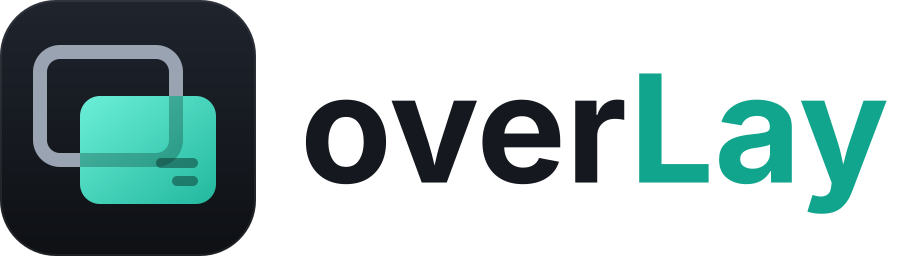

# overLay

<p align="center">
  <picture>
    <source media="(prefers-color-scheme: dark)" srcset="assets/branding/overlay/logo-dark.svg">
    
  </picture>
</p>

> English original. German version: [README.de.md](README.de.md)

**overLay** is a lean, open-source overlay manager for games on **Linux (native, Wine, Proton)** and **Windows**. It installs and runs **overlay mods**: small web apps that show live game information on top of your game, such as a Hearthstone deck tracker.

The launcher is inspired by the dock-based look of popular overlay platforms, but overLay is built to be small and transparent:

- **No telemetry, no ads.** The host and every mod in the official index are free of analytics, trackers and ad SDKs.
- **Open source only.** Every mod in the official index has public source code, an OSI-approved license and a reproducible build.
- **Verified updates.** Updates are downloaded, checked against signed hashes, and activated only afterwards. New permissions need your approval.
- **Your repos too.** Besides the official index you can add your own mod repositories by URL and public key.
- **Lightweight.** A native Rust core with the system WebView, no bundled browser engine, and no code injection into games.

> **Status: pre-alpha (phase 0).** Nothing is usable yet. See the [roadmap](ROADMAP.md).

## First mod: Flint


**Flint** is a Hearthstone companion with deck tracker, opponent tracker, Battlegrounds and Arena helpers. Its feature set and look follow Firestone, but Flint is an independent clean-room implementation. Its primary target is the **native Linux client** launched through [hearthstone-linux-gui](https://github.com/DawnMagnet/hearthstone-linux-gui) (no Wine); Wine/Proton and Windows are supported too. Flint will live in its own repository and be installed through the mod index.

## Repository layout

| Path | Contents |
|---|---|
| `crates/` | Rust crates of the host: `overlay-app` (Tauri app: core, launcher and overlay processes), `overlay-ipc`, `overlay-games`, `overlay-settings`, `overlay-i18n` |
| `ui/` | Launcher UI (Svelte 5, TypeScript, Vite) |
| `locales/` | Fluent catalogs of the host, shared by Rust and UI (`en` base, `de`) |
| `sdk/` | Mod SDK and TypeScript types (phase 3) |
| `mods/` | Example mods (phase 3) |
| `assets/branding/` | Logos of overLay and Flint ([details](assets/branding/README.md)) |
| `games/` | Game catalog: which processes belong to which game |
| `tools/` | Repository scripts (logo generator, `measure.sh` for RAM/CPU) |
| `docs/` | Research and design documents |
| `spikes/` | Throwaway measurement projects, not part of CI |

## Development

Requirements: [rustup](https://rustup.rs) (installs the pinned toolchain automatically) and Node.js 26 (see `.nvmrc`). On Linux, Tauri also needs a few system libraries (Debian/Ubuntu/Mint):

```bash
sudo apt install libwebkit2gtk-4.1-dev libxdo-dev libayatana-appindicator3-dev librsvg2-dev
```

Install the JavaScript dependencies:

```bash
npm ci
```

Run the host app with hot reload:

```bash
npm run app:dev
```

Build installable packages (`.deb`, AppImage, MSI):

```bash
npm run app:build
```

Work on the UI alone in a browser (sample data instead of the host):

```bash
npm run dev
```

Run the Rust tests:

```bash
cargo test
```

All checks that CI runs:

```bash
npm run format:check && npm run check && npm run build && npm run licenses && cargo fmt --all --check && cargo clippy --all-targets -- -D warnings && cargo test && cargo deny check
```

## Documentation

- [Roadmap](ROADMAP.md)
- [Research: Overwolf, CurseForge, Firestone](docs/research.md)
- [Mod policy](MOD_POLICY.md)
- [Contributing](CONTRIBUTING.md) · [Code of conduct](CODE_OF_CONDUCT.md) · [Security](SECURITY.md)
- [Changelog](CHANGELOG.md)

## License

overLay is licensed under the [GNU General Public License v3.0 or later](LICENSE).

overLay is not affiliated with or endorsed by Overwolf, CurseForge, Blizzard Entertainment or Zero to Heroes (Firestone). All trademarks belong to their respective owners.
